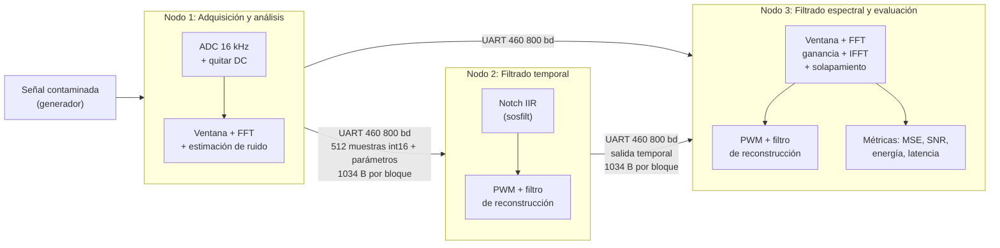

# Parte a

El compromiso consiste en la reducción de ruido, la cual es medida con el ΔSNR y la atenuación del ruido, y la distorsión de la señal útil, la cual se mide con la energía útil conservada y en parte con el MSE, por lo tanto, un buen compromiso es aquel que logra una buena reducción sin bajar considerablemente la energía útil.

**Tabla 1.** Mejora de SNR (ΔSNR) y energía útil conservada por método y caso de prueba.
| Caso    | Temporal: ΔSNR / E. útil | Espectral: ΔSNR / E. útil |
| -------- | ------- | ------- |
| 1 tonal  | +19.4 dB / 99.6 %   | +36.4 dB / 99.9 % |
| 2 blanco | +0.1 dB / 100.3 %     | +9.9 dB / 98.2 % |
| 3 banda    | +0.04 dB / 97.8 %    | +7.5 dB / 87.2 % |
*Fuente: `resultados/metricas.csv`, segmento desde t = 1 s.*

El método espectral es el mejor entre los dos en los tres casos, ya que este obtuvo la mayor mejora de ΔSNR (+36.4, +9.9 y +7.5 dB), además, conservando al menos 98% de la energía útil en los casos 1 y 2, pero en el caso tonal, la mayor ΔSNR de parte del método espectral no necesariamente se debe a una mejor eliminación de la interferencia, ya que el filtro notch elimino la interferencia mejor que la espectral (más de 100 dB de atenuación contra 56.5 dB del espectral), pero tiene un ΔSNR menor. 

Esto se debe a que hubo un desfase de aproximadamente -10 grados, a pesar de que la ganancia sea casi 0 dB (-0.14 dB), el MSE compara muestra por muestra, entonces penaliza ese desfase. 

El espectral por otra parte modifica casi nada fuera de los bins de ruido, entonces por consecuencia conserva mejor la fase de los tonos.
 
Al elegir los siguientes criterios: ΔSNR ≥ 6 dB (la potencia del error baja a una cuarta parte) y energía útil ≥ 95 % (perdida de apenas 0.2 dB), se tendría que él espectral cumple el caso 1 y 2 pero falla 3, y el temporal solo cumple el caso 1. 

Además, vale la pena mencionar el costo de los filtros, el temporal usa 36 B y unos 8 µs por bloque, el espectral utiliza unos 20 KB y unos 210 µs, estos tiempos están muy por debajo de los 32 ms disponibles.

# Parte B

## Filtro temporal
La condición para que falle el filtro temporal es que directamente el ruido no se encuentre en 1750 Hz y esto se puede evidenciar al ver que en los casos 2 y 3 tuvo un ΔSNR demasiado bajo, casi 0, esto se debe a que el mismo filtro es un sistema LTI, y este tiene un cero fijo en e^{±jω₀}, por lo tanto solo atenúa una banda angosta de aproximadamente unos 175 Hz con un Q=10 y este no se puede adaptar, otra falla encontrada es que a pesar de que acierte con la frecuencia, este filtro distorsiona la fase de los tonos cercanos, entonces, si la interferencia estuviera cerca de un tono útil (el tono de 1320 Hz a 430 Hz del notch ya sufre -10 grados de desfase y -0.14 dB), este se vería atenuado.

## Filtro espectral

Por otro lado, para que el filtro espectral falle la señal útil debe compartir frecuencias con el ruido, esto se puede apreciar en el caso 3, ya que solo conserva el 87.2% de la energía útil y el ΔSNR final queda en 10.5 dB, la cual es la peor de los tres casos, esta falla se debe a que el método aplica una ganancia por bin, si un bin contiene a la vez ruido y señal, esta no los puede separar, para poder quitar el ruido se debería atenuar la señal.

Además, es relevante mencionar que solo se realizó una corrida por caso, que las señales son sintéticas y que los tiempos fueron medidos en una computadora, por lo tanto no refleja el comportamiento del microcontrolador.

# Parte c: Frecuencia de muestreo, tamaño de bloque y formato numérico

Las tres decisiones se tomaron en conjunto, porque la frecuencia de muestreo y el formato determinan la tasa de comunicación entre nodos y el tamaño de bloque determina la resolución, la latencia y la memoria.

## Frecuencia de muestreo: fs = 16kHz.

Para evitar aliasing, fs debe superar el doble de la frecuencia más alta que llegue al ADC, incluido el ruido y no solo la señal útil: una componente de ruido por encima de fs/2 se reflejaría dentro de la banda útil y ningún filtro digital podría separarla después. 

El modo de prueba aleatoria ubica la interferencia hasta 0.40·fs = 6.4 kHz y la banda de ruido hasta 0.46·fs ≈ 7.4 kHz, ambas por debajo de fs/2 = 8 kHz. 

Por lo tanto, 16 kHz cubre todas las condiciones previstas, coincide con la frecuencia de las señales de prueba y está muy por debajo de la capacidad del ADC del RP2040. 

Una frecuencia mayor no aportaría información útil y aumentaría proporcionalmente la tasa de comunicación.

## Tamaño de bloque: N = 1024 con salto de 512 muestras

Con esta configuración: la resolución espectral es Δf = fs/N = 15.6 Hz, suficiente para separar la interferencia de los tonos útiles (el más cercano a 1750 Hz está a 430 Hz);
cada bloque dura N/fs = 64 ms, y cada 512/fs = 32 ms se dispone de un bloque nuevo, que es el límite de tiempo real para procesarlo;
la memoria estimada del método espectral es de 5124 valores, unos 20 KB en float32, frente a los 264 KB de RAM del RP2040 (de los cuales una parte la ocupan el intérprete de MicroPython).

Esta es la configuración con la que se obtuvieron los resultados de la Tabla 1. En la computadora, el método espectral tardó 115 µs por bloque, muy por debajo de los 32 ms disponibles. Ese margen debe confirmarse en el microcontrolador, porque el RP2040 es mucho más lento que una computadora.

## Formato numérico.

Se propone transmitir las muestras como enteros de 16 bits (int16) y procesarlas en float32 con ulab. El ADC del RP2040 es de 12 bits, por lo que cada muestra cabe en un int16 sin pérdida; además, el Nodo 1 elimina el componente DC al restar el valor medio, lo que deja muestras con signo. Este formato fija 2 bytes por muestra para el cálculo de la tasa de comunicación de la pregunta e.

El procesamiento se hace en float32 porque es el tipo de dato de ulab. Su principal riesgo es que el RP2040 no tiene unidad de punto flotante, de modo que cada operación en float se emula por software; por eso el tiempo por bloque debe medirse en el Pico y no extrapolarse de la computadora. Respecto a los coeficientes del notch, el análisis de cuantización de la sección 2.3h mostró que con float32 el filtro conserva la estabilidad (|p| = 0.966), y la misma SNR que con float64 (24.46 dB en el caso 1), además en punto fijo Q2.12 el desempeño no cambia; la degradación aparece en Q2.8, donde la atenuación de la interferencia cae a 19.6 dB y la SNr a 21.4 dB. Dado que float32 conserva la estabilidad y el desempeño del filtro, no es necesario recurrir a punto fijo para los coeficientes.

# Parte d: Bibliotecas disponibles para el Raspberry Pi Pico W

El firmware se desarrollará en MicroPython, por lo que la biblioteca seleccionada es **ulab**, un módulo escrito en C que implementa un subconjunto de NumPy y SciPy para MicroPython.

**Tabla 2.** Biblioteca de procesamiento seleccionada para el Raspberry Pi Pico W.

| Aspecto | ulab |
| --- | --- |
| Funciones que se usarán | `ulab.numpy.fft.fft` / `ifft` (método espectral, Nodos 1 y 3) y `ulab.scipy.signal.sosfilt` (notch IIR, Nodo 2) |
| Licencia | MIT |
| Precisión numérica | float de precisión simple (32 bits) en el RP2040 |
| Limitaciones conocidas | La FFT solo acepta longitudes potencia de 2. El firmware oficial de MicroPython no incluye ulab, por lo que se requiere una compilación que lo integre. Todo el cálculo en float se emula por software, porque el RP2040 no tiene FPU. La memoria está limitada al heap de MicroPython. |

ulab cubre las dos operaciones que el sistema necesita: la FFT/IFFT del método espectral y el filtrado IIR del método temporal, por lo que no se requiere otra biblioteca. Para el filtro temporal se usará `sosfilt` sobre el bloque completo, en lugar de implementar la ecuación de diferencias con un ciclo muestra por muestra en Python: a 16 kHz, un ciclo interpretado por muestra no cumpliría el límite de 32 ms por bloque, mientras que `sosfilt` ejecuta el ciclo en C.

La FFT de ulab se comparará contra la implementación de referencia en Python (NumPy) usando el mismo bloque de entrada, y se reportará el error máximo con una tolerancia declarada. De la misma forma, la salida de `sosfilt` se comparará contra la de `scipy.signal.lfilter` usada en la sección 2.3.

# Parte e: Arquitectura de los tres nodos y comunicación

**Función de cada nodo.** La arquitectura sigue la Figura 1 del enunciado del proyecto:

- **Nodo 1 (adquisición y análisis):** muestrea a 16 kHz con el ADC, elimina el componente DC, aplica la ventana, calcula la FFT y estima los parámetros del ruido (frecuencia interferente y nivel de ruido).
- **Nodo 2 (filtrado temporal):** recibe las muestras y los parámetros, aplica el notch IIR y reproduce su salida por PWM con filtro de reconstrucción. Además, envía su salida al Nodo 3 para la comparación.
- **Nodo 3 (filtrado espectral y evaluación):** recibe las muestras y los parámetros, aplica el método FFT/IFFT, reproduce su salida por PWM y calcula las métricas de ambos métodos (MSE, SNR antes y después, energía conservada).

Como los Nodos 2 y 3 no tienen ADC propio, las muestras de la señal contaminada deben viajar desde el Nodo 1. Para comparar ambos métodos, la salida del Nodo 2 debe viajar al Nodo 3.

**Figura 1.** Diagrama de bloques del sistema y datos transmitidos entre nodos.

**Formato de la trama.** Cada bloque se envía en una trama con delimitación y detección de errores.

**Tabla 3.** Formato de la trama enviada por bloque.

| Campo | Contenido | Bytes |
| --- | --- | --- |
| Sincronía | Patrón fijo que marca el inicio del bloque | 2 |
| Número de bloque | Contador que permite detectar bloques perdidos | 2 |
| Parámetros | Frecuencia interferente estimada (uint16, Hz) y nivel de ruido (uint16) | 4 |
| Muestras | 512 muestras nuevas en int16 | 1024 |
| CRC-16 | Verificación de errores de la trama | 2 |
| **Total** | | **1034** |

Solo se transmiten las 512 muestras nuevas de cada bloque, no las 1024: con 50 % de solapamiento, la otra mitad ya la recibió el nodo en la trama anterior, así que transmitirla duplicaría el ancho de banda sin aportar información. La trama del Nodo 2 al Nodo 3 tiene el mismo formato, con la salida filtrada en el campo de muestras.

**Tasa mínima de comunicación.**

- Bloques por segundo: fs / 512 = 16000 / 512 = 31.25 bloques/s.
- Bytes por segundo: 1034 B × 31.25 = 32 312 B/s por enlace.
- En UART cada byte se transmite con 10 bits (8 de datos, 1 de inicio y 1 de parada), por lo que la tasa mínima es 32 312 × 10 ≈ 323 000 baudios.

La consecuencia práctica se ve al comparar el tiempo que tarda una trama en transmitirse con los 32 ms disponibles por bloque:

**Tabla 4.** Tiempo de transmisión de una trama de 1034 B según la velocidad del UART.

| Velocidad UART | Tiempo por trama | Uso del enlace | Cumple 32 ms? |
| --- | --- | --- | --- |
| 115 200 bd | 89.8 ms | 280 % | No |
| 460 800 bd | 22.4 ms | 70 % | Sí |
| 921 600 bd | 11.2 ms | 35 % | Sí, con más margen |

La velocidad típica de 115 200 baudios no alcanza: cada trama tardaría casi tres veces más de lo que dura un bloque y los búferes se desbordarían. Se propone 460 800 baudios, que deja un 30 % de margen. Si las pruebas en el Pico muestran pérdidas de bloques, el siguiente 
